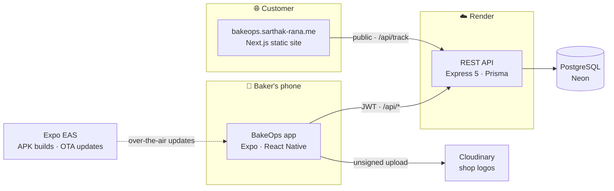
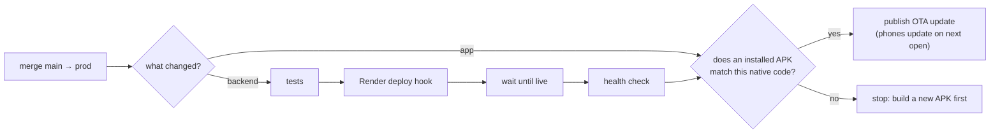

<div align="center">

# 🎂 BakeOps

**The order book, billing desk and delivery planner for home bakers, in one app.**

[Website](https://bakeops.sarthak-rana.me) · [Track an order (demo)](https://bakeops.sarthak-rana.me/track/?demo=1) · [Download the Android app](https://bakeops.sarthak-rana.me/download/) · [Report a bug](https://github.com/Sarthak2845/BakeOps/issues/new/choose)


[](https://github.com/Sarthak2845/BakeOps/actions/workflows/backend-ci.yml)

</div>

---

## Why BakeOps

Home bakers run their business from WhatsApp chats and a notebook. Delivery dates get missed, advances are hard to keep track of, and customers keep messaging *"is my cake ready?"*

BakeOps started with one real user, a home baker, and is built around a baker's day:
- what has to go out today;
- what to bake for tomorrow;
- who still owes money;
- which regular customer's birthday is coming up.

## Features

**For the baker (Android app)**
- **Today dashboard:** today's deliveries in time order, a 7-day strip, the prep list (what to bake, with quantities combined across orders), late orders, and upcoming customer occasions.
- **Orders:** create an order in seconds with customer and product pickers and a delivery date and time. Move it through *Inquiry → Confirmed → Baking → Ready → Delivered*.
- **Customers:** customer records keyed by phone number, with saved occasions (birthdays, anniversaries) that show up on the dashboard before they come round.
- **Product catalog:** your menu and prices, suggested while creating orders. Bulk import from pasted text, or from items in past orders, loads a whole menu at once.
- **Invoices and receipts:** auto-numbered invoices with your shop's logo, PDF receipts, and a public receipt link.
- **Money:** what's due, overdue and received this week. Settle a balance with *Mark paid*.
- **Customer tracking links:** send a link on WhatsApp; the customer sees live status, items, balance due and their receipt.
- **Insights:** monthly revenue, top-selling items and repeat-customer rate.
- **Polish:** an animated first-launch onboarding, light, dark and system themes, and error messages on every screen.

**For the baker's customers (website)**
- [bakeops.sarthak-rana.me/track/…](https://bakeops.sarthak-rana.me/track/?demo=1): a tracking page that refreshes every 15 seconds and works without a login or an app.

## How it fits together



- **Multi-tenant:** every shop's data is scoped to its business. Public endpoints (tracking, receipts) expose only what a customer needs: the customer's first name, the items and the amounts.
- **The app talks only to the API.** Logos go straight from the phone to Cloudinary, and the API accepts only URLs from the configured Cloudinary account.

## Tech stack

| Part | Built with |
|---|---|
| **App** (`frontend/`) | Expo SDK 57, React Native, expo-router, TanStack React Query, TypeScript |
| **API** (`backend/`) | Node.js 24, Express 5, Prisma 7 (`@prisma/adapter-pg`), PostgreSQL, zod, JWT, pino, pdfkit |
| **Website** (`website/`) | Next.js 15 (static export), React 19 |
| **Tests and CI** | Jest + Supertest integration tests on a real Postgres in GitHub Actions |
| **Hosting** | Render (API and static site, from [`render.yaml`](render.yaml)), Neon Postgres, Cloudinary |
| **App delivery** | EAS Build (APK, no Play Store), EAS Update (over-the-air updates) |

## Repository layout

```
BakeOps/
├── backend/        REST API: auth, business, customers, products, orders, invoices, public tracking and receipts
│   ├── prisma/       schema and migrations
│   ├── src/modules/  one folder per module: routes → controller → service, plus zod schemas
│   └── tests/        integration tests (Jest + Supertest)
├── frontend/       Android app (Expo); see frontend/README.md and frontend/RELEASING.md
├── website/        brand site and customer order tracking (Next.js); see website/README.md
├── render.yaml     Render Blueprint: dev API, prod API, static website
└── .github/        CI, production deploy workflow, issue and PR templates
```

## Run it locally

You need **Node.js 24**, a **PostgreSQL** database (a free [Neon](https://neon.tech) project works, or local Postgres), and for the app either **Expo Go** (SDK 57) on an Android phone or an Android emulator.

**1. API** (http://localhost:4000)
```bash
cd backend
cp .env.example .env        # set DATABASE_URL and JWT_SECRET
npm install
npm run prisma:migrate      # creates the tables
npm run dev
```

**2. App**
```bash
cd frontend
cp .env.example .env        # EXPO_PUBLIC_API_URL: on a real phone, use your computer's LAN IP, e.g. http://192.168.1.23:4000
npm install
npx expo start              # scan the QR code with Expo Go, or press "a" for an emulator, "w" for web
```

**3. Website** (http://localhost:3000, optional)
```bash
cd website
cp .env.example .env.local
npm install
npm run dev
```

Each part has more detail in its own guide:
- [backend/README.md](backend/README.md): API reference, logging and debugging, deploying.
- [frontend/README.md](frontend/README.md): the app's screens, settings and structure.
- [website/README.md](website/README.md): pages, tracking links and settings.

## Environments and releases

| | Dev | Production |
|---|---|---|
| **Branch** | `main` | `prod` |
| **API** | `bakeops-api-dev`, redeploys when `main` passes CI | `bakeops-api`, deployed only by the release workflow |
| **App** | `preview` APK, update channel `preview` | `production` APK, update channel `production` |
| **Website** | — | `bakeops-site` → [bakeops.sarthak-rana.me](https://bakeops.sarthak-rana.me) |

**Releasing** means opening a pull request from `main` into `prod`. Merging it runs [Deploy to production](.github/workflows/deploy-prod.yml):



- **App changes reach phones without a reinstall** through EAS Update. A new APK is needed only when native code changes: a new native library, an Expo SDK upgrade, or native settings. The workflow detects this and refuses to publish an update the installed apps can't run.
- **The website** deploys from `prod` by itself.
- Full steps, including building APKs, publishing updates by hand and rolling back, are in [frontend/RELEASING.md](frontend/RELEASING.md).

## Tests

```bash
cd backend
npm test          # integration tests against DATABASE_URL; each test creates and cleans up its own shop
npm run typecheck
```

CI ([backend-ci.yml](.github/workflows/backend-ci.yml)) runs migrations, the typecheck, the tests and a build against a fresh Postgres 16 on every push and pull request that touches the backend. The app and website are checked with `npx tsc --noEmit`.

## How work is done

- Every change starts as a GitHub **issue**, created from the bug or feature [templates](.github/ISSUE_TEMPLATE).
- Each issue gets its own branch and pull request (`feat/…`, `fix/…`, `docs/…`), which closes the issue when it merges.
- Pull requests merge into `main` (dev). Releases are `main` → `prod` pull requests.
- The original product plan is in [Bakery-Business-Platform-PRD.md](Bakery-Business-Platform-PRD.md).

## Roadmap

- [ ] Reminder notifications for deliveries, prep, payments and occasions (#37)
- [ ] Topper Studio: search images, remove backgrounds and print cake-topper sheets (#35)
- [ ] Admin console with per-shop feature switches (#36)
- [ ] Import old orders from a notebook (handwritten Hindi or Marathi → spreadsheet → app)
- [ ] Online ordering page for each shop, with UPI advances

## Author

Built by **Sarthak Rana**: [sarthak-rana.me](https://sarthak-rana.me) · [GitHub @Sarthak2845](https://github.com/Sarthak2845)
